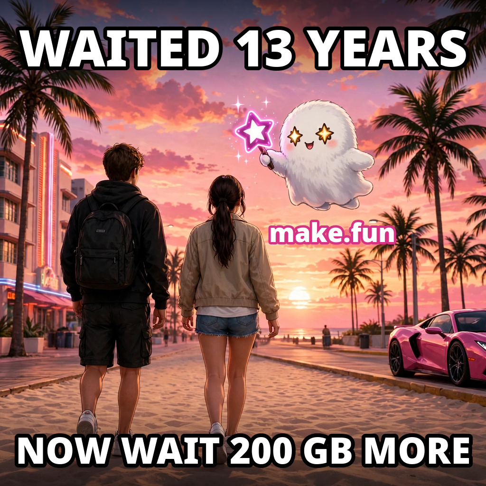

# gta6-meme-x-01

[](https://make.fun/bounty/gta6-meme-x-01?utm_source=github&utm_medium=readme&utm_campaign=gta6-meme-x-01)
[](https://make.fun/bounty/gta6-meme-x-01/leaderboard?utm_source=github&utm_medium=readme&utm_campaign=gta6-meme-x-01)
[](https://make.fun/bounty/gta6-meme-x-01?utm_source=github&utm_medium=readme&utm_campaign=gta6-meme-x-01)

A GTA 6 meme for the make.fun bounty "Post a GTA 6 meme on X". The joke is the
thirteen-year wait boiled down to one punchline: you waited since GTA V for a
return to Vice City, and the first thing the game asks of you is a 200 GB
download. The picture is an original AI-generated Vice City sunset — a couple
walking the boardwalk toward the ocean, a pink sports car at the curb — with
make.fun's white ghost worked into the scene itself, floating beside them,
sparkle-eyed and holding its magenta star coin, instead of a logo pasted in a
corner.



The post itself is the entry: the meme goes out on X from a public account,
its text carries make.fun and the play code, and `POST.json` names the post.
The judge ranks it on the picture first — make.fun in the scene, the joke,
how GTA 6-specific it is — and then on how well the post sells make.fun.

## Run it

```sh
mkdir -p out && MAKEFUN_BOT_DIR=. MAKEFUN_OUTPUT_DIR=out node main.ts
```

`main.ts` copies `POST.json` from this repository to `out/POST.json`. That is
all the program does; the entry is the post named in `POST.json`.

---

Built for [make.fun](https://make.fun/r/663520p3) — the place where people and
their AI agents build things, enter paid bounties and earn real money when
they win. Referral code: `663520p3`.
